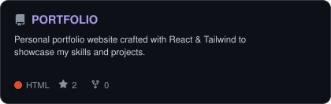
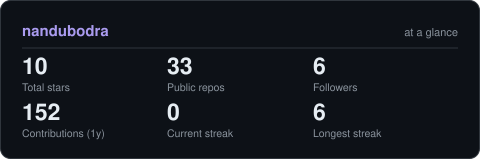
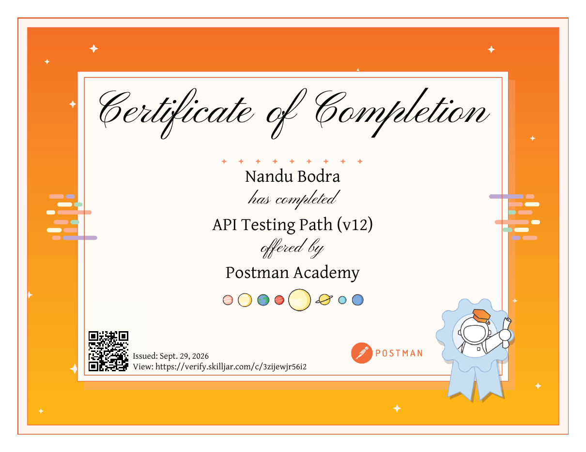

<!-- BANNER - terminal profile.sh --live (additive). Generated by scripts/banner/generate.py
     from assets/source/photo.png. Cache-bust with ?v=N after regenerating. -->
<picture>
  <source media="(prefers-color-scheme: dark)"  srcset="assets/banner-dark.v9.svg">
  <source media="(prefers-color-scheme: light)" srcset="assets/banner-light.v9.svg">
  
</picture>

 

<!-- NAME / TAGLINE - animated typing -->

 

<!-- SOCIALS - LinkedIn stays brand blue (glyph vanishes on custom fills). Others themed.
     Add your LinkedIn / Instagram / X links by uncommenting and editing the lines below. -->
&nbsp;&nbsp;

<!--&nbsp;&nbsp;
&nbsp;&nbsp;
&nbsp;&nbsp;

-->

 

---

## Hi 👋, I'm Nandu Bodra

💻 **Java | DSA | Web Development Learner**

### 🚀 About Me

- 🎓 Passionate **computer application learner** with strong programming skills, seeking opportunities to innovate and collaborate.
- 🌱 I'm currently learning **Web Development & DSA**.
- 💻 Programming languages: **Java, C, C++, HTML, CSS, JavaScript**.
- 🎯 Goal: become a **Full Stack Developer**.
- ⚡ Fun fact: I love coding and building cool projects.

 

## 🌐 Connect With Me

&nbsp;&nbsp;

---

## 🛠️ Languages & Tools

---

## signals

<table>
<tr>
<td width="50%" align="center" valign="middle">

<!-- Self-rated radar - edit assets/skills.json, the workflow redraws it -->
<picture>
  <source media="(prefers-color-scheme: dark)"  srcset="assets/radar-dark.svg">
  <source media="(prefers-color-scheme: light)" srcset="assets/radar-light.svg">
  
</picture>

</td>
<td width="50%" align="center" valign="middle">

<!-- Hand-authored language radar - edit assets/langmix.json -->
<picture>
  <source media="(prefers-color-scheme: dark)"  srcset="assets/radar-langs-dark.svg">
  <source media="(prefers-color-scheme: light)" srcset="assets/radar-langs-light.svg">
  
</picture>

</td>
</tr>
</table>

---

## 🔥 Featured Projects

<!-- Generated by scripts/cards.py from assets/projects.json (repo name must match exactly). -->
<a href="https://nandubodra.github.io/PORTFOLIO/">
<picture>
  <source media="(prefers-color-scheme: dark)"  srcset="assets/card-PORTFOLIO-dark.svg">
  <source media="(prefers-color-scheme: light)" srcset="assets/card-PORTFOLIO-light.svg">
  
</picture>
</a>

📈 <b>Personal Portfolio Website</b> · crafted with React &amp; Tailwind to showcase skills and projects ·
🔗 <a href="https://nandubodra.github.io/PORTFOLIO/">Visit Portfolio</a>

<!-- PROJECT SCREENSHOT (optional): drop assets/portfolio-preview.png and uncomment
  

-->

---

## Numbers matter? ohhh yes.

<!-- Generated by scripts/cards.py into this repo. Deliberately NOT
     github-readme-stats / streak-stats / github-profile-trophy: those are
     shared public instances that go down and take the whole section with them. -->
<picture>
  <source media="(prefers-color-scheme: dark)"  srcset="assets/card-stats-dark.svg">
  <source media="(prefers-color-scheme: light)" srcset="assets/card-stats-light.svg">
  
</picture>

 

---

## 📜 My Certificates

<table>
<tr>
<td width="50%" align="center" valign="top">
 
<b>Cybersecurity Analyst Job Simulation</b> Tata · Forage · Feb 2026
</td>
<td width="50%" align="center" valign="top">
 
<b>API Testing Path (v12)</b> Postman Academy · Sept 2026 · <a href="https://verify.skilljar.com/c/3zijewjr56i2">verify</a>
</td>
</tr>
</table>

---

## ❤️ Let's Collaborate!

I'm always up for contributing to impactful open-source projects, collaborating on interesting
frontend/backend tools, or building mini products that solve real problems. Feel free to connect!

<i>"Keep building, keep learning, and never stop growing."</i> 🌱

⭐ From <a href="https://github.com/nandubodra/">Nandu Bodra</a> · build with love

